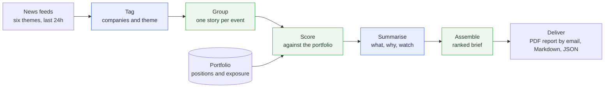

# Capital Manager Daily Brief

A daily, portfolio-aware news briefing for a capital or asset manager. It reads the day's financial news, merges coverage of the same event into one story, ranks each story by how much it matters to a specific portfolio, and puts a short "moves your book today" summary at the top.

**Status:** working prototype. This repository is a showcase: it describes the project and shows a real sample of its output. The source code is not published here and is available on request.

## What it does

1. **Gathers** the last 24 hours of news across six themes: semiconductors, nuclear and data centres, financials, AI in finance, global macro, and defence.
2. **Tags** each article with the companies, the theme and the type of event it reports (for example an export control, a rate cut or a contract win).
3. **Groups** multi-outlet coverage of the same event into a single story, so one event appears once.
4. **Scores** each story against the portfolio and assigns a priority (critical, high, medium, low).
5. **Summarises** each story in three parts: what happened, why it matters to this portfolio, and what to watch.
6. **Assembles** a ranked brief and delivers it each morning.

## Flow



Blue steps use AI; green steps are rules-based. A scheduled job runs the whole flow once each morning.

## How it is built

| Step | How | Why |
|---|---|---|
| News ingestion | RSS feeds, one set of queries per theme, with the daily article cap shared evenly across themes | Free, no API key, and no theme crowds out the others |
| Grouping | Rules-based text similarity, with optional embeddings | Repeatable: the same input gives the same stories |
| Scoring | Rules-based, in plain Python | Every score can be explained and tuned |
| Entity tagging and summaries | AI (Claude) | The only steps that need language judgement |
| Delivery | PDF report by email, Markdown and JSON files | Readable by a person and by other tools |
| Scheduling | Daily job | Runs unattended each morning |

The score of a story combines five components: whether it names a position held in the portfolio, how exposed the portfolio is to the story's theme, how material the event is, the quality of the sources, and how recent it is. The weights live in one configuration file, so the ranking can be tuned without touching the logic.

AI is deliberately kept out of the ranking. Grouping, scoring and priorities are rules-based so the result can be defended; AI is used only for tagging and story summaries. When it tags an event it picks a label from a fixed list; how much each type of event weighs is set in the configuration, never by the AI. Summaries are written only for stories that will actually be shown, with a daily limit that stretches slightly for critical stories, which keeps the cost to a few cents a day. If no AI is available, the pipeline still runs and falls back to extractive summaries.

## Sample output

Two unedited briefs produced from live news:

| Date | Input | Result |
|---|---|---|
| [8 October 2026](sample-output/daily-brief-2026-10-08.md) | Scheduled morning run | 2 stories shown: 1 critical, 1 medium |
| [14 November 2026](sample-output/daily-brief-2026-11-14.md) ([PDF report](sample-output/daily-brief-2026-11-14.pdf)) | 48 articles, 8 per theme | 42 stories: 1 critical, 9 medium, 32 low |

The second sample shows the filtering at work: 48 articles across all six themes become 42 stories, and only the handful that matter to this portfolio reach the reader. Its lead story merges coverage from six outlets into one entry.

The PDF is the version the manager receives by email. Besides the stories it charts the day's findings: stories by theme and by priority, where the portfolio is exposed against where the news is, what drove the top scores, and which holdings were named.

The portfolio in both ("Growth Book") is a made-up sample, not a real account. The summaries restate what the cited outlets reported on the day; they are not verified facts or investment advice.

## Example: how to read a story

Every story in the brief has the same shape. This one is from the 8 October sample:

```
### [CRITICAL] Jensen Huang May Be the Most Dangerous Man in AI
semiconductors | positions: NVDA | mixed/unclear | score 61.9 | Stocktwits, TechRepublic, The Free Press
```

| Part | Meaning |
|---|---|
| `[CRITICAL]` | Priority, derived from the score: critical, high, medium or low. Low-priority stories are left out of the full list and kept only in the JSON file, unless they name a holding. |
| Title | The headline of the lead article in the group. |
| `semiconductors` | The theme the story belongs to. |
| `positions: NVDA` | The portfolio holdings the story names. A dash means no holding is named and the story ranks on theme exposure alone. |
| `mixed/unclear` | A soft read of direction (bullish, bearish or mixed). It is a hint, not a recommendation. |
| `score 61.9` | The rules-based score that sets the ranking. |
| Outlet names | Every outlet whose coverage was merged into this one story. Three outlets here means three articles became one entry. |

The paragraph under the header always answers three questions, in this order:

1. **What happened** — a Chinese AI lab is reportedly seeking more chip access shortly after an export-control breach was flagged, while an analyst calls the stock undervalued.
2. **Why it matters to this portfolio** — the company is 20% of the sample portfolio, which also has 40% exposure to semiconductors, and the two signals point in opposite directions.
3. **What to watch** — any official confirmation or enforcement action on the alleged breach.

The highest-ranked stories that name a holding are repeated at the top under "Moves your book today", so the first screen answers the manager's first question: does anything today touch what I own?

## Testing

23 automated tests cover grouping, scoring, priorities, the even split of articles across themes, event recognition, the daily cost limit, the report layout, delivery, and the end-to-end run on a fixed sample news day.

## How it was made

Built with AI coding assistants under my direction. I defined what the brief should tell a portfolio manager, which steps must be rules-based, and how stories are scored; I reviewed and tested the result.

## Rights

© 2026 Vasileios Grigorios Pappas. All rights reserved. No licence is granted to copy, modify or reuse this material.
